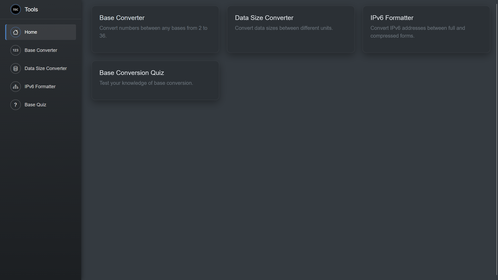

# Tools

Small collection of web tools for my class at data- og kommunikationsuddannelsen - built with C# and Blazor WebAssembly.

Built to practice C# and web development, and to provide practical tools for students at TEC.

**Try it live:** https://ivaneriksen.github.io/tools/



## Tools

- **Base Converter** - convert numbers between any bases from 2 to 36. Validates input and gives clear error messages for invalid digits, bases and numbers that are too large.
- **Data Size Converter** - enter an amount and a unit and see it in all units at once: bits, bytes, network units (kbit, Mbit...), decimal units (kB, MB...) and binary units (KiB, MiB...). Updates live as you type.
- **IPv6 Formatter** - turn an IPv6 address into its short, trimmed and full forms, with copy buttons. Validates the address and updates live as you type.
- **Base Conversion Quiz** - practice converting between binary, octal, decimal and hex. Pick bases and difficulty (4, 8 or 16 bits), play freely or take a 60-second challenge with a high score saved locally in your browser.

## Tech stack

- C# / .NET 10
- Blazor WebAssembly
- Bootstrap 5 with a custom dark theme
- xUnit for unit tests
- GitHub Actions for automatic build and deployment
- GitHub Pages for hosting

## Run locally

Requirements: .NET 10 SDK and Visual Studio (or another C# editor).

1. Clone the repo: `git clone https://github.com/ivaneriksen/tools.git`
2. Open `Tools.sln` in Visual Studio.
3. Set `BaseConverter.Web` as the startup project.
4. Press F5.

## Project structure

```
Tools.sln
├── BaseConverter.Core     Class library with the logic for all tools (no UI)
├── BaseConverter.Web      Blazor WebAssembly site (pages, layout, styling)
├── BaseConverter.Tests    xUnit tests for the logic in Core
└── BaseConverter          Console app for quick manual testing
```

## Testing

The logic in `BaseConverter.Core` is covered by xUnit tests, including edge cases (invalid input, overflow, negative numbers) and round-trip tests. Run them with `dotnet test` or from Test Explorer in Visual Studio.

## Deployment

Every push to `master` triggers a GitHub Actions workflow (`.github/workflows/deploy.yml`). It runs all tests first - if any test fails, the deploy is stopped, so broken code never reaches the live site. If the tests pass, the site is published to GitHub Pages.
